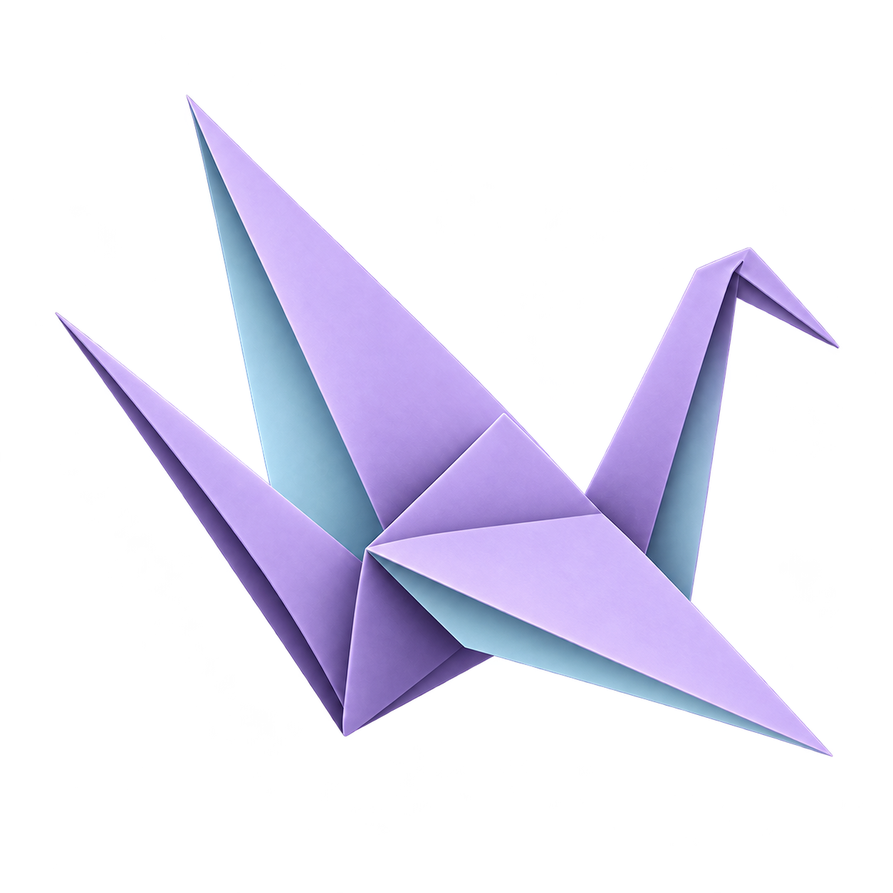

<p align="center">
  
</p>

# Perch

Keep an eye on your GitHub pull requests from your Mac’s menu bar. See what is ready, what needs work, and what was merged—all in one place.

## What it does

- Shows your open pull requests, drafts, and merges from the last 24 hours.
- Lets you choose which GitHub repos to watch. A repo is a project stored on GitHub.
- Shows review status and whether checks passed.
- Groups pull requests that build on each other into stacks.
- Lets you name a stack and copy its links to share with your team.
- Opens pull requests on GitHub and lets you close them from the app.
- Refreshes every minute, or when you ask it to.

Perch can also add a `merge` label to a pull request. If your repo uses that label to start a merge queue, this can send it to the queue. Perch does not merge code itself.

## Get started

You need macOS 14 or later and the [GitHub CLI](https://cli.github.com/). Perch works on Apple Silicon and Intel Macs.

1. [Download Perch.zip](https://github.com/rhart92/perch/releases/latest/download/Perch.zip).
2. Open the ZIP file and drag **Perch** to your Applications folder.
3. Sign in to GitHub with the commands below. If you do not have [Homebrew](https://brew.sh/), install it first.

```sh
brew install gh
gh auth login
```

Open Perch from your Applications folder. It stays in the menu bar, not the Dock.

Perch is not signed with an Apple developer certificate or checked by Apple. macOS may block it the first time you open it. If you trust this download, open **System Settings → Privacy & Security** and choose **Open Anyway** after trying to launch it.

Click the layers icon in your menu bar. Choose the repos you want to watch, then click **Done**. Perch only shows pull requests you wrote in those repos.

## Build it yourself

You only need these steps if you want to build Perch from its source code. Install Apple’s command line tools with `xcode-select --install`, then run these commands from the Perch folder:

```sh
./build.sh
open dist/Perch.app
```

The build bundles the bird logo from `assets/perch.png` as the app icon. The menu bar keeps its layers icon.


## Your account

Perch uses your GitHub CLI sign-in. It does not store a separate GitHub token or need a local copy of your repos. Your repo choices and stack names stay on your Mac.
